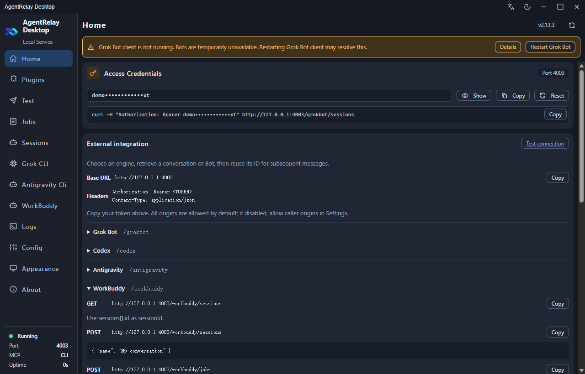
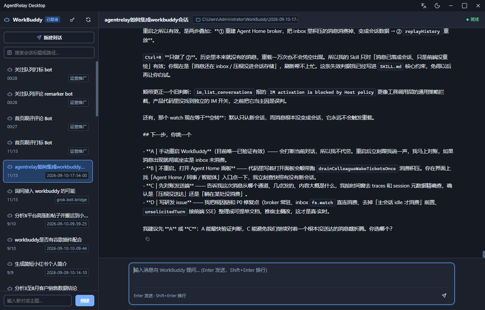
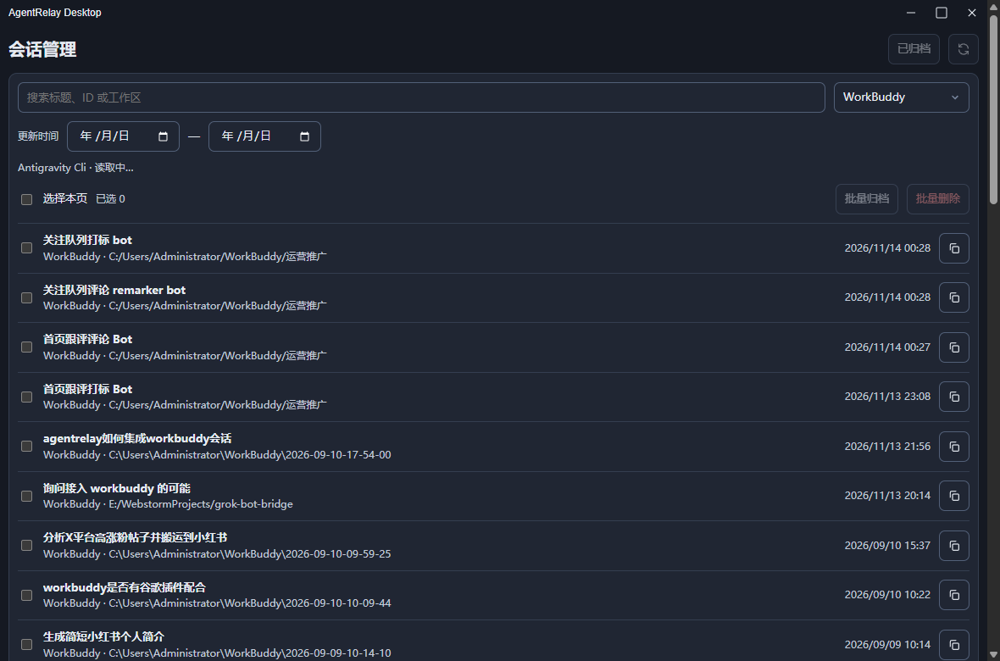
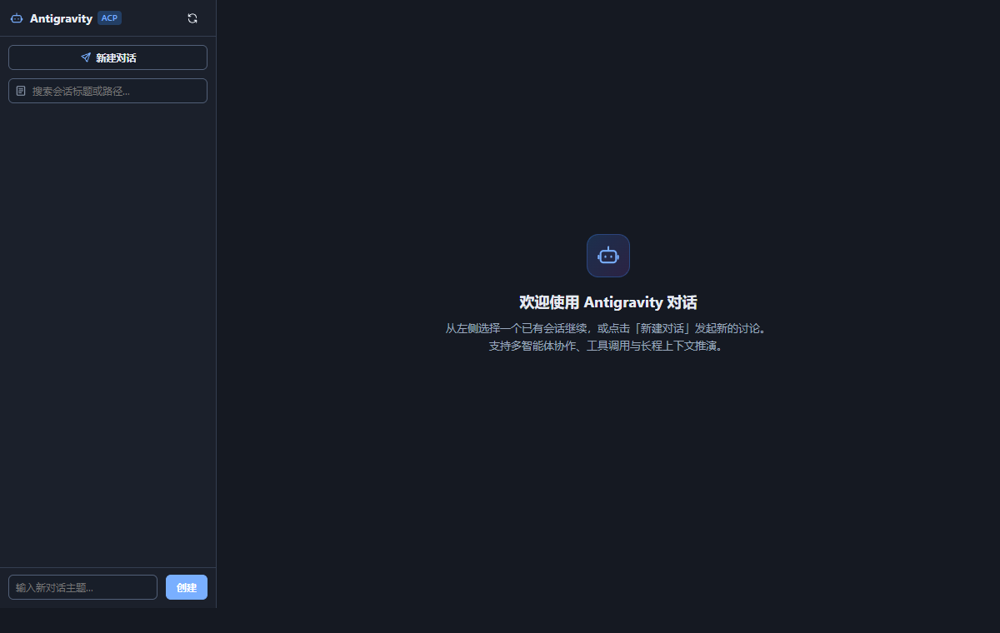
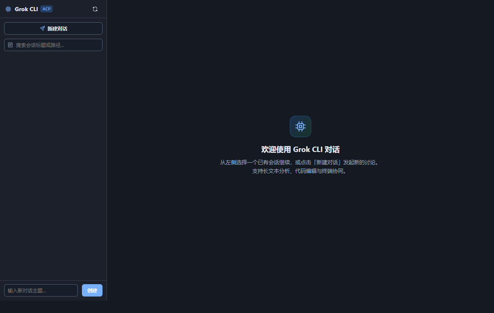

# AgentRelay

[English](README.md) · [简体中文](README.zh-CN.md) · [Português (Brasil)](README.pt-BR.md) · [Español](README.es.md)

**2.14.0 · Windows 10/11 x64 · Solo instalador EXE · Sitio oficial: [GoodExts](https://goodexts.com) ([Página de AgentRelay](https://goodexts.com/es/agentrelay))**

AgentRelay, desarrollado por [GoodExts](https://goodexts.com), conecta Codex, Grok Bot, Antigravity, Grok CLI, DeepSeek Harness y WorkBuddy locales. Codex, Antigravity, Harness, Grok CLI y Antigravity CLI admiten mensajes nativos en turnos activos o follow-ups verificados; WorkBuddy se incorpora como sexto motor con reutilización de sesiones de escritorio, inicio de sesión aislado por QR oficial, ventana de chat `/ui/workbuddy`, barra rápida de copiado por mensaje y rutas públicas `/workbuddy/jobs`.

## 2.14.0 — Compatibilidad Codex 26.1120 app-tools y aislamiento de controladores

- Conserva la ruta heredada `codex-ipc` (`steerOwner` / `compactOwner`) como primera opción y agrega soporte explícito al pipe `codex-app-tools` de Codex `26.1120` (`POST /codex/follow-up`, `GET /codex/follow-ups/{operationId}`, `GET /codex/capabilities` y `POST /codex/jobs` con `deliveryMode: "follow_up"`).
- Mantiene la fidelidad de Steer estricto: sin `codex-ipc`, `/codex/steer`, `/steer` y `/ui/api/codex/steer` devuelven HTTP `501 steer_unsupported` (`delivery: "not_sent"`) en lugar de degradarse silenciosamente a follow-up.
- Comparte reserva persistente, detección de conflictos (`409`) y recuperación de solo lectura de estados no terminales (`dispatching`/`accepted`/`unknown`), verificando `sourceThreadId` y `sourceTurnId` mediante `read_thread` antes de enviar y diferenciando `confirmed_same_turn` de `started_new_turn` mediante la carga nativa de delegación.
- Añade saneamiento de variables de entorno (`cleanAgentEnv`), ejecución directa de wrappers `.cmd`/`.bat` en Windows sin shell (`launchOf`), clasificación uniforme de errores (`writer_busy`/`auth`/`quota`) y fallo rápido `COMPACTION_UNSUPPORTED` en hilos vacíos de Codex.
- Verificado en Windows x64 contra Codex `26.1120.5083.0` real (`confirmed_same_turn`, `started_new_turn`, `501 steer_unsupported`, conflictos `409` y conservación de AppData); las rutas heredadas `codex-ipc` se probaron con fixtures aisladas. `strictSteer` y `ownerCompaction` siguen sin soporte en Codex `26.1120`; consulte el recibo original sin reenviar automáticamente.

## Capturas de pantalla

### Panel de control y chat de WorkBuddy
| Panel de control | Chat de WorkBuddy (`/ui/workbuddy`) |
| --- | --- |
|  |  |

### Gestor de sesiones y ventanas nativas
| Gestor de sesiones (`/ui/sessions`) | Antigravity (`/ui/antigravity`) | Grok CLI (`/ui/grok-cli`) |
| --- | --- | --- |
|  |  |  |

## Descarga y actualización

[EXE para Windows x64](https://github.com/wangsen2020/agentrelay-releases/releases/download/v2.14.0/AgentRelay-2.14.0-win-x64.exe) · [SHA-256](https://github.com/wangsen2020/agentrelay-releases/releases/download/v2.14.0/SHA256SUMS.txt) · [Notas de versión](https://github.com/wangsen2020/agentrelay-releases/releases/tag/v2.14.0)

Espera a que terminen las tareas, cierra la aplicación y ejecuta el EXE. La configuración y los registros se conservan en el AppData existente. Esta versión se instala manualmente; el actualizador anterior basado en ZIP no es su vía de actualización.

## Elige la skill

- [agentrelay-session-bridge](agentrelay-session-bridge/SKILL.md): asignación entre sesiones existentes, recibos directos y colaboración por eventos.

- [agentrelay-integration](agentrelay-integration/SKILL.md): integración de extensiones/clientes mediante jobs y recuperación de la tarea original.

- [agentrelay-local-rebuild](agentrelay-local-rebuild/SKILL.md): reconstrucción Windows para responsables con acceso autorizado al código privado.

## Instala la colaboración directa

Copia toda la carpeta `agentrelay-session-bridge` a `~/.codex/skills/` o al directorio de skills de tu herramienta. Conserva scripts, references y agents. Requiere Node.js 22+, AgentRelay 2.11.0+ local y clientes nativos con sus propias sesiones iniciadas.

Indica a la IA: “Usa $agentrelay-session-bridge para asignar esta tarea a la sesión existente elegida. Incluye la sesión actual del coordinador para devolver el resultado y envía DONE o BLOCKED de forma proactiva.”

Incluye el provider/sessionId real del coordinador actual. Steer estricto entra en un turno activo; los jobs ordinarios activan una sesión inactiva. Solo encola una notificación al mismo coordinador tras no_active_turn explícito y autorización del contrato. No reenvíes entregas inciertas.

## Verificación y límites

En Windows se verificaron las seis direcciones entre tres clientes, con nonces coincidentes y dos recibos DONE en el mismo turno activo de Codex. Aceptación, recepción y finalización son evidencias distintas.

La prueba no demuestra continuación automática de Codex inactivo, recuperación de fallos, ejecución ilimitada ni un porcentaje fijo de ahorro. El contexto no se comparte automáticamente; se mantienen las cuentas, cuotas y permisos de cada producto.

El código de la aplicación es privado. Las skills públicas contienen herramientas de API e instrucciones, sin credenciales ni código del servicio.

[Sitio oficial de GoodExts](https://goodexts.com) · [Producto y guías de AgentRelay](https://goodexts.com/es/agentrelay)
