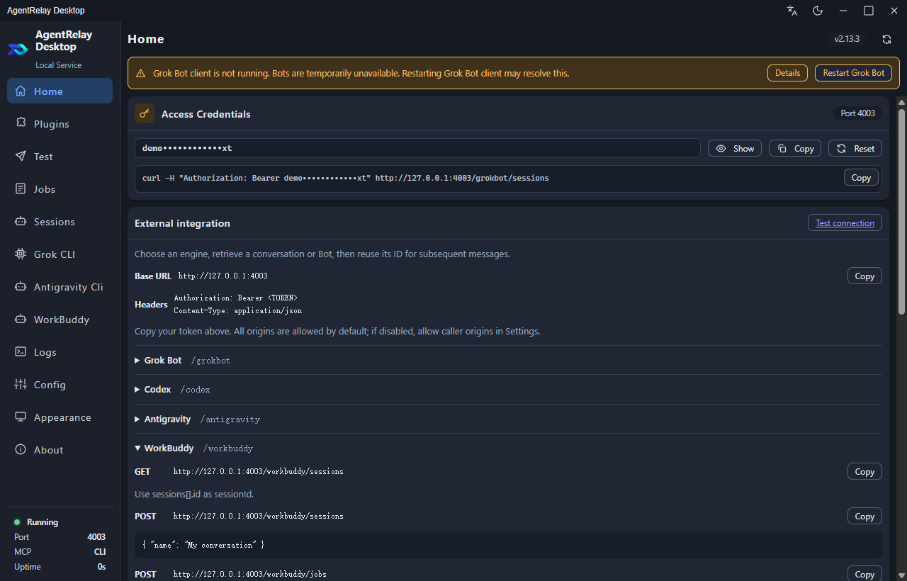
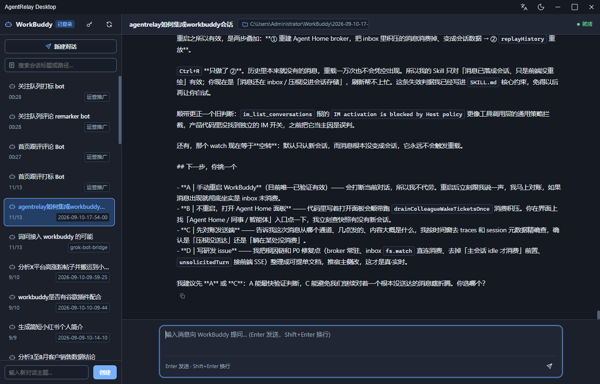
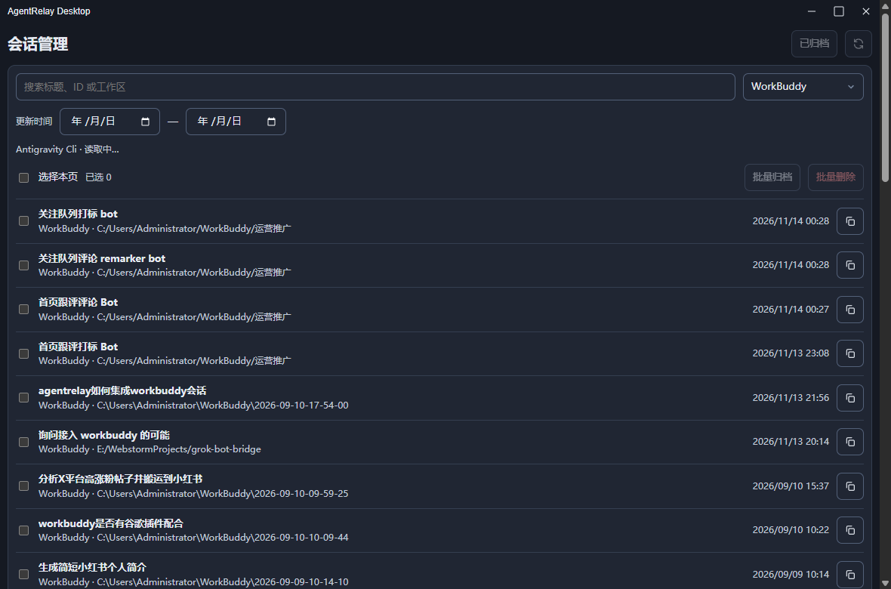
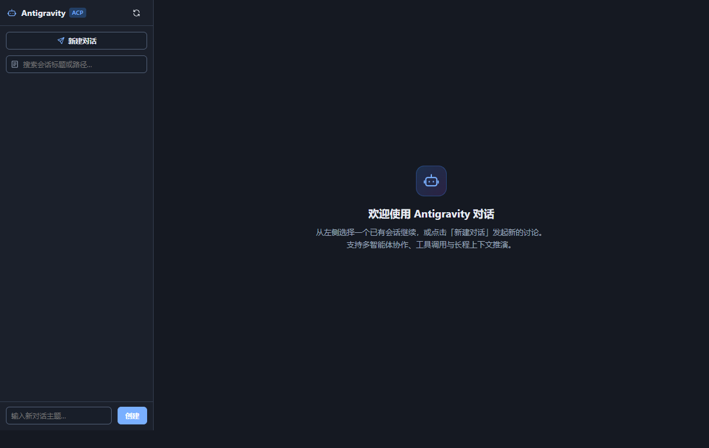
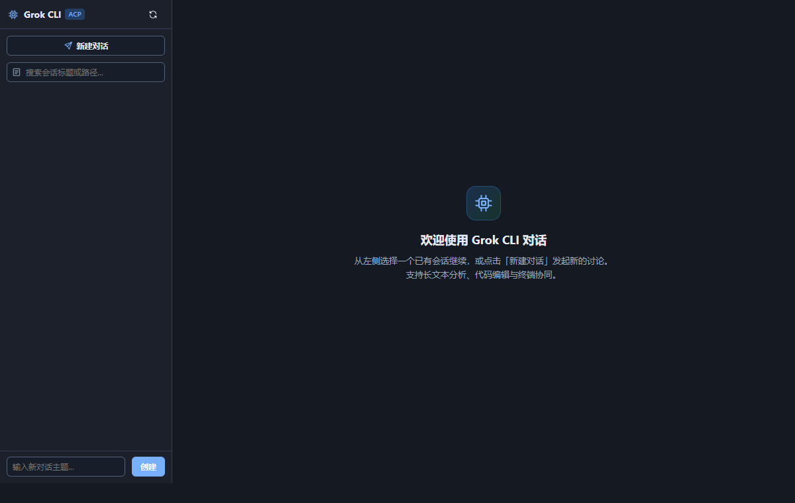

# AgentRelay

[English](README.md) · [简体中文](README.zh-CN.md) · [Português (Brasil)](README.pt-BR.md) · [Español](README.es.md)

**2.13.3 · Windows 10/11 x64 · EXE installer only · Official Website: [GoodExts](https://goodexts.com) ([AgentRelay Product Page](https://goodexts.com/agentrelay))**

AgentRelay, built by [GoodExts](https://goodexts.com), connects compatible local Codex, Grok Bot, Antigravity, Grok CLI, DeepSeek Harness and WorkBuddy clients. Codex, Antigravity, Harness, Grok CLI and Antigravity CLI support native messages into active turns, while WorkBuddy adds desktop session reuse, an isolated official login namespace, a dedicated chat board (`/ui/workbuddy`), and public `/workbuddy/jobs` routing.

## Screenshots

### Desktop Control Panel & WorkBuddy Chat
| Control Panel | WorkBuddy Chat (`/ui/workbuddy`) |
| --- | --- |
|  |  |

### Session Manager & Native Client Boards
| Session Manager (`/ui/sessions`) | Antigravity (`/ui/antigravity`) | Grok CLI (`/ui/grok-cli`) |
| --- | --- | --- |
|  |  |  |

## Download

[Windows x64 installer](https://github.com/wangsen2020/agentrelay-releases/releases/download/v2.13.3/AgentRelay-2.13.3-win-x64.exe) · [SHA-256 checksums](https://github.com/wangsen2020/agentrelay-releases/releases/download/v2.13.3/SHA256SUMS.txt) · [Release notes](https://github.com/wangsen2020/agentrelay-releases/releases/tag/v2.13.3)

Wait for active tasks to finish, explicitly quit the app, then run the EXE to upgrade. Configuration and job records remain in the existing AppData directory. This EXE-only release uses manual installation; the older ZIP-based updater is not its upgrade path.

## Choose the right skill

| Skill | Use it for |

| --- | --- |

| [agentrelay-session-bridge](agentrelay-session-bridge/SKILL.md) | Assigning work across existing AI sessions, native direct receipts and event-driven collaboration |

| [agentrelay-integration](agentrelay-integration/SKILL.md) | Connecting an extension or client through ordinary jobs and original-job recovery |

| [agentrelay-local-rebuild](agentrelay-local-rebuild/SKILL.md) | Windows rebuild and local acceptance for maintainers with authorized access to private application source |

## Install the direct-collaboration skill

Copy the entire `agentrelay-session-bridge` folder into `~/.codex/skills/` (or the appropriate skill directory of your coding tool). Keep `scripts/`, `references/` and `agents/` together. It requires Node.js 22+ and local AgentRelay 2.11.0+ with available, signed-in native clients.

Ask your AI: “Use $agentrelay-session-bridge to assign this task to the selected existing AI session. Include this current orchestrator session as the reply address, and require a proactive DONE or BLOCKED receipt.”

The orchestrator must provide its actual current provider/session ID and bounded task scope. Active turns receive strict Steer; an explicitly idle session uses ordinary jobs. A receipt may queue once to the same idle orchestrator only when its task contract allows that fallback. Unknown delivery is preserved, never blindly resent.

## Verification and boundaries

On Windows, all six directions among Codex, Antigravity and Harness were verified with matching nonce challenges; both DONE receipts reached the same active Codex turn. Service acceptance, actual reception and task completion are separate evidence levels.

Idle Codex continuation, crash self-recovery, unlimited unattended work and a fixed cost-savings percentage were not established by this test. Context is not shared automatically. Each AI product retains its own account, quota and permissions.

Application source remains private. These public skills contain generic API helpers and workflow instructions, not model credentials or service source. Third-party components retain their licenses.

[GoodExts Official Website](https://goodexts.com) · [AgentRelay Product and Setup Guides](https://goodexts.com/agentrelay)
