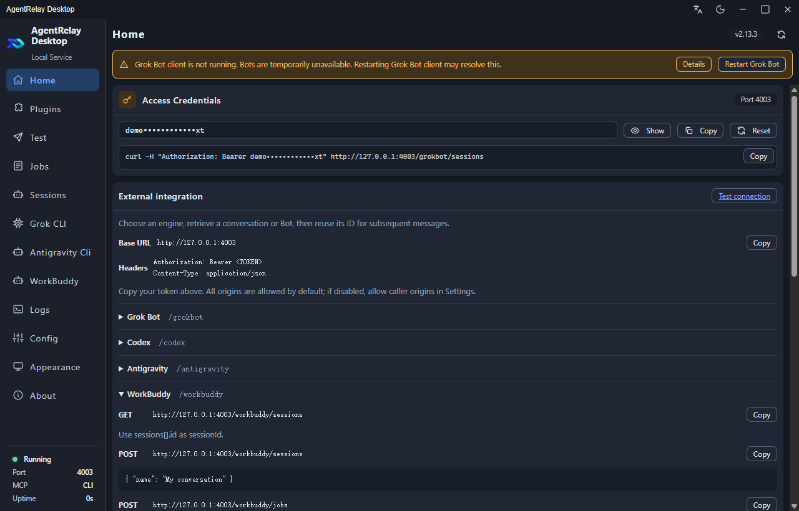
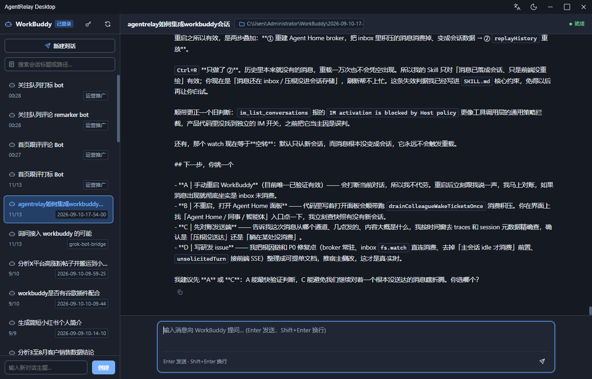
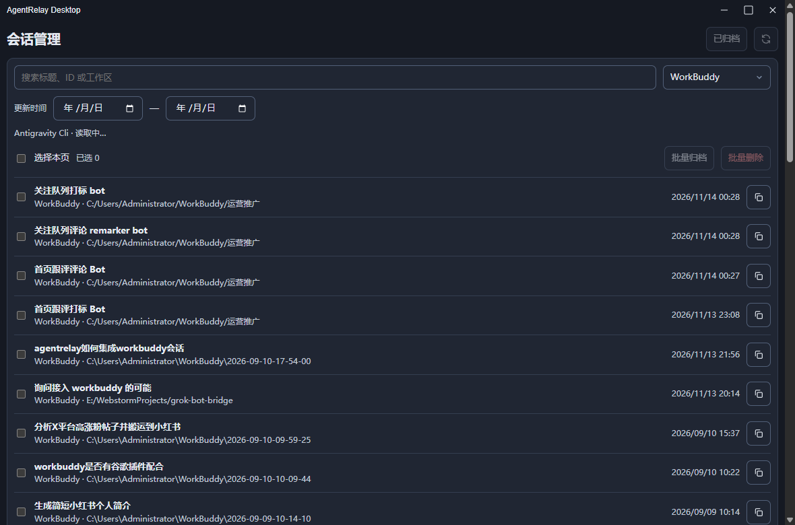
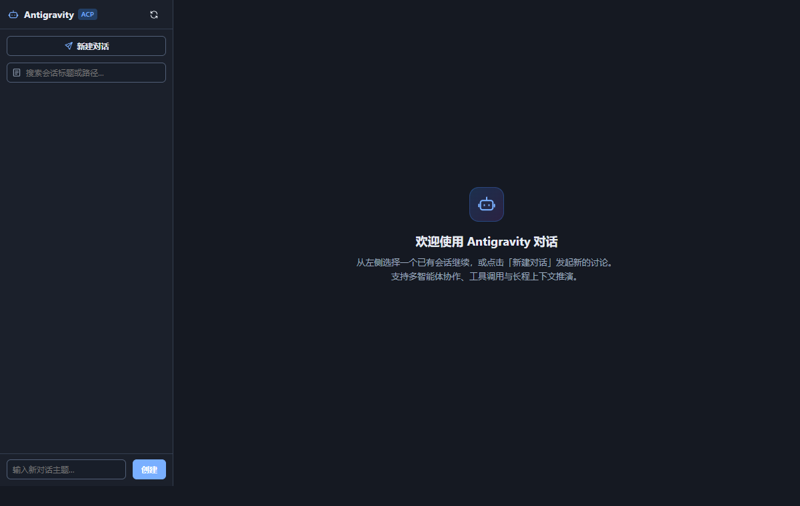
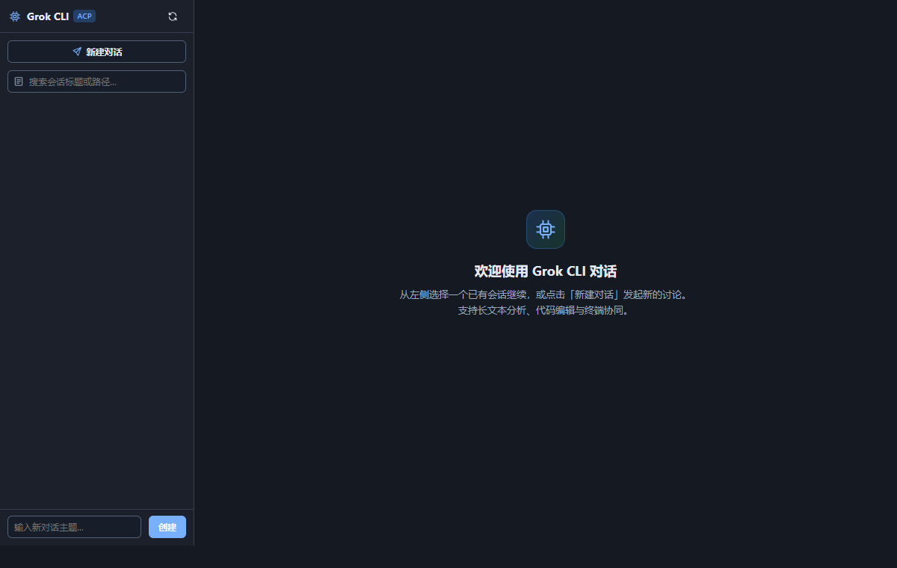

# AgentRelay

[English](README.md) · [简体中文](README.zh-CN.md) · [Português (Brasil)](README.pt-BR.md) · [Español](README.es.md)

**2.14.0 · Windows 10/11 x64 · Somente instalador EXE · Site oficial: [GoodExts](https://goodexts.com) ([Página do AgentRelay](https://goodexts.com/pt-br/agentrelay))**

O AgentRelay, desenvolvido pela [GoodExts](https://goodexts.com), conecta Codex, Grok Bot, Antigravity, Grok CLI, DeepSeek Harness e WorkBuddy locais. Codex, Antigravity, Harness, Grok CLI e Antigravity CLI aceitam mensagens nativas em turnos ativos ou follow-ups verificados; o WorkBuddy passa a integrar como 6º motor com reutilização de sessões do desktop, login QR isolado, janela `/ui/workbuddy`, barra rápida de cópia por mensagem e endpoints públicos `/workbuddy/jobs`.

## 2.14.0 — Compatibilidade Codex 26.1120 app-tools e isolamento de drivers

- Preserva o caminho legado `codex-ipc` (`steerOwner` / `compactOwner`) como prioridade e adiciona suporte explícito ao pipe `codex-app-tools` do Codex `26.1120` (`POST /codex/follow-up`, `GET /codex/follow-ups/{operationId}`, `GET /codex/capabilities` e `POST /codex/jobs` com `deliveryMode: "follow_up"`).
- Mantém a semântica estrita de Steer: sem `codex-ipc`, `/codex/steer`, `/steer` e `/ui/api/codex/steer` retornam HTTP `501 steer_unsupported` (`delivery: "not_sent"`) em vez de converter silenciosamente em follow-up.
- Compartilha reserva persistente, detecção de conflito (`409`) e recuperação somente leitura de estados não terminais (`dispatching`/`accepted`/`unknown`), exigindo `read_thread` de origem real antes do envio e diferenciando `confirmed_same_turn` de `started_new_turn` via carga nativa de delegação.
- Adiciona higienização de variáveis de ambiente (`cleanAgentEnv`), abertura direta de wrappers `.cmd`/`.bat` no Windows sem shell (`launchOf`), classificação uniforme de erros (`writer_busy`/`auth`/`quota`) e falha rápida `COMPACTION_UNSUPPORTED` em threads Codex vazias.
- Verificado no Windows x64 com Codex `26.1120.5083.0` real (`confirmed_same_turn`, `started_new_turn`, `501 steer_unsupported`, conflitos `409` e preservação do AppData); caminhos legados `codex-ipc` foram verificados com fixtures isoladas. `strictSteer` e `ownerCompaction` seguem sem suporte no Codex `26.1120`; consulte o recibo original sem reenviar automaticamente.

## Capturas de tela

### Painel de controle e chat do WorkBuddy
| Painel de controle | Chat do WorkBuddy (`/ui/workbuddy`) |
| --- | --- |
|  |  |

### Gerenciador de sessões e janelas nativas
| Gerenciador de sessões (`/ui/sessions`) | Antigravity (`/ui/antigravity`) | Grok CLI (`/ui/grok-cli`) |
| --- | --- | --- |
|  |  |  |

## Download e atualização

[EXE para Windows x64](https://github.com/wangsen2020/agentrelay-releases/releases/download/v2.14.0/AgentRelay-2.14.0-win-x64.exe) · [SHA-256](https://github.com/wangsen2020/agentrelay-releases/releases/download/v2.14.0/SHA256SUMS.txt) · [Notas da versão](https://github.com/wangsen2020/agentrelay-releases/releases/tag/v2.14.0)

Aguarde as tarefas terminarem, encerre o aplicativo e execute o EXE. A configuração e os registros permanecem no AppData existente. Esta versão requer instalação manual; o atualizador antigo baseado em ZIP não é o caminho de atualização.

## Escolha a skill

- [agentrelay-session-bridge](agentrelay-session-bridge/SKILL.md): delegação entre sessões existentes, recibos diretos e colaboração orientada a eventos.

- [agentrelay-integration](agentrelay-integration/SKILL.md): integração de extensões/clientes por jobs e recuperação da tarefa original.

- [agentrelay-local-rebuild](agentrelay-local-rebuild/SKILL.md): reconstrução Windows para mantenedores com acesso autorizado ao código privado.

## Instale a colaboração direta

Copie a pasta inteira `agentrelay-session-bridge` para `~/.codex/skills/` ou o diretório de skills da sua ferramenta. Preserve scripts, references e agents. Requer Node.js 22+, AgentRelay 2.11.0+ local e clientes nativos conectados às respectivas contas.

Peça à IA: “Use $agentrelay-session-bridge para delegar esta tarefa à sessão existente escolhida. Inclua a sessão atual do coordenador como endereço de retorno e envie DONE ou BLOCKED proativamente.”

Use o provider/sessionId real do coordenador atual. Steer estrito entrega no turno ativo; jobs comuns ativam uma sessão ociosa. Só enfileire uma notificação de resultado para o mesmo coordenador após no_active_turn explícito e autorização no contrato. Não reenvie entregas incertas.

## Verificação e limites

As seis direções entre três clientes foram verificadas no Windows com nonces correspondentes e dois recibos DONE no mesmo turno ativo do Codex. Aceitação, recebimento e conclusão são estados diferentes.

O teste não comprova continuação automática do Codex ocioso, recuperação de falhas, execução ilimitada ou um percentual fixo de economia. Contextos não são compartilhados automaticamente; contas, cotas e permissões continuam válidas.

O código do aplicativo permanece privado. As skills públicas contêm ferramentas de API e instruções, sem credenciais ou código do serviço.

[Site oficial da GoodExts](https://goodexts.com) · [Produto e guias do AgentRelay](https://goodexts.com/pt-br/agentrelay)
