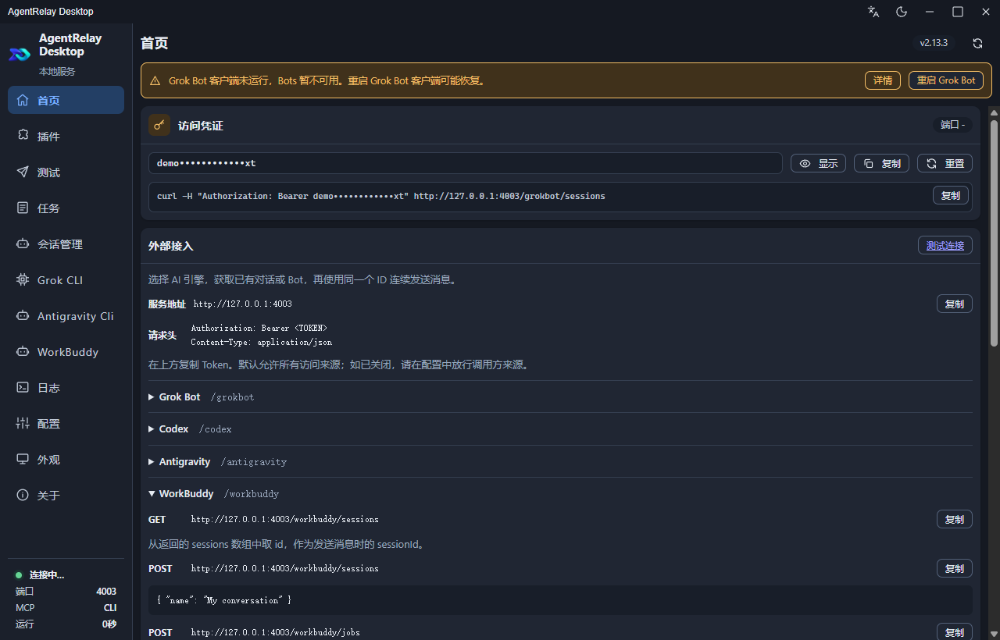
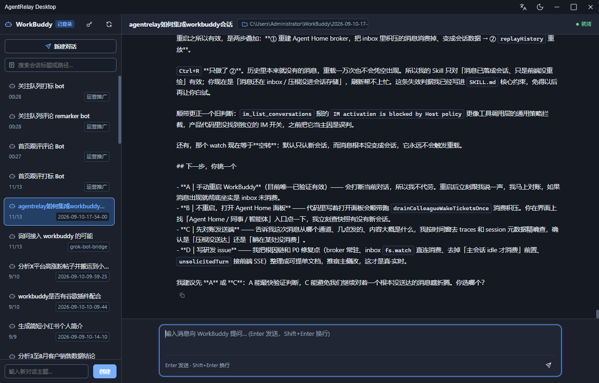
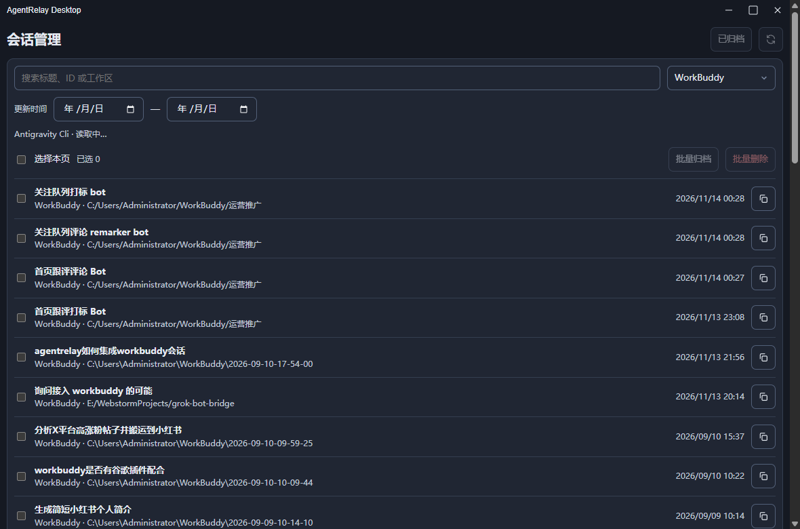
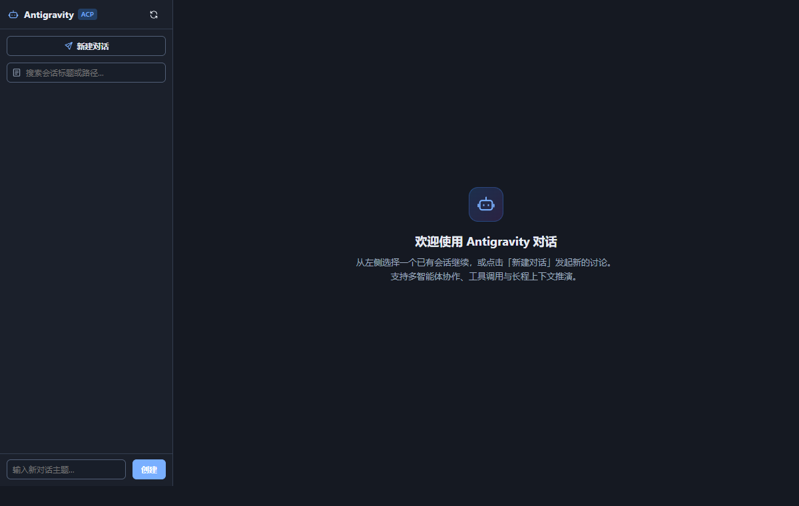
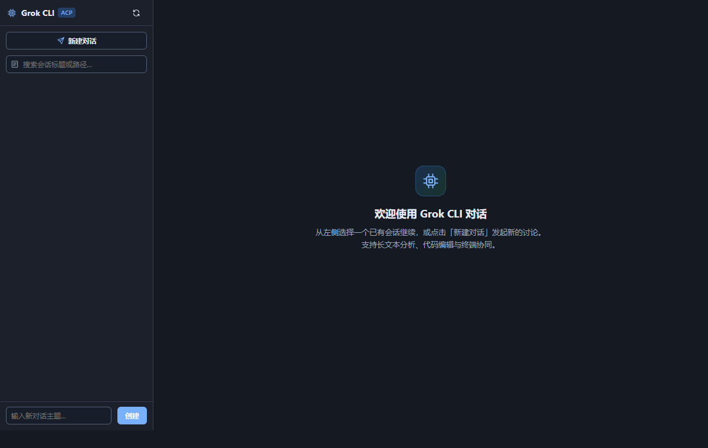

# AgentRelay

[English](README.md) · [简体中文](README.zh-CN.md) · [Português (Brasil)](README.pt-BR.md) · [Español](README.es.md)

**2.14.0 · Windows 10/11 x64 · 仅 EXE 安装包 · 官网：[GoodExts](https://goodexts.com)（[AgentRelay 产品页](https://goodexts.com/zh/agentrelay)）**

AgentRelay 由 [GoodExts 官网](https://goodexts.com) 出品，用于连接本机 Codex、Grok Bot、Antigravity、Grok CLI、DeepSeek Harness 与 WorkBuddy。Codex、Antigravity、Harness、Grok CLI 及 Antigravity CLI 支持活动轮次原生直达引导或核验跟进；WorkBuddy 现已作为第 6 引擎接入，支持桌面端会话复用、独立官方扫码登录、`/ui/workbuddy` 独立对话窗口、三端消息底部快捷复制栏与公共 `/workbuddy/jobs` 接口。

## 2.14.0 — Codex 26.1120 app-tools 兼容与驱动环境隔离

- 保留旧版 Codex `codex-ipc`（`steerOwner` / `compactOwner`）优先直连路径，并新增支持新版 `26.1120` `codex-app-tools` 管道的显式跟进接口（`POST /codex/follow-up`、`GET /codex/follow-ups/{operationId}`、`GET /codex/capabilities` 及 `POST /codex/jobs` 的 `deliveryMode: "follow_up"`）。
- 严格遵守 Steer 语义边界：缺失 `codex-ipc` 且仅有 `codex-app-tools` 时，严格 `/codex/steer`、`/steer` 与 `/ui/api/codex/steer` 统一返回 HTTP `501 steer_unsupported`（`delivery: "not_sent"`），不静默降级为可新建轮次的 follow-up。
- 新旧版共用持久化操作保留、请求指纹冲突校验（`409`）及非终态（`dispatching`/`accepted`/`unknown`）只读恢复；发送前强制通过 `read_thread` 核验真实 `sourceThreadId` 与来源 turn，仅依据原生委派载荷或完整预期输入区分 `confirmed_same_turn` 与 `started_new_turn`。
- 新增跨引擎环境变量隔离（`cleanAgentEnv`）、Windows `.cmd`/`.bat` 免 Shell 解包启动（`launchOf`）、`writer_busy`/`auth`/`quota` 错误归一化（`classifyAgentError`），并在零轮次 Codex 会话请求原生压缩时快失败（`COMPACTION_UNSUPPORTED`）。
- 已在 Windows x64 实机验证 Codex `26.1120.5083.0` 与本机安装版（`confirmed_same_turn`、`started_new_turn`、`501 steer_unsupported`、`409` 冲突拒收与 AppData 保留）；旧版 `codex-ipc` 路径通过隔离夹具与桩函数验证。Codex `26.1120` 原生 `strictSteer` 与 `ownerCompaction` 仍不支持，未知或中断收据保留原编号只读查询，不盲目重发。

## 界面截图

### 桌面控制面板与 WorkBuddy 对话窗口
| 桌面控制面板 | WorkBuddy 对话窗口（`/ui/workbuddy`） |
| --- | --- |
|  |  |

### 会话管理与原生客户端独立看板
| 会话管理（`/ui/sessions`） | Antigravity（`/ui/antigravity`） | Grok CLI（`/ui/grok-cli`） |
| --- | --- | --- |
|  |  |  |

## 下载与升级

[Windows x64 EXE](https://github.com/wangsen2020/agentrelay-releases/releases/download/v2.14.0/AgentRelay-2.14.0-win-x64.exe) · [SHA-256 校验](https://github.com/wangsen2020/agentrelay-releases/releases/download/v2.14.0/SHA256SUMS.txt) · [发行说明](https://github.com/wangsen2020/agentrelay-releases/releases/tag/v2.14.0)

等待活跃任务结束，明确退出软件后运行 EXE 覆盖安装，保留原 AppData 配置与任务记录。本版手动升级，不将旧 ZIP 自动更新通道作为此次升级路径。

## 选择技能

- [三方直达协作 agentrelay-session-bridge](agentrelay-session-bridge/SKILL.md)：AI 会话派单、活动轮次直达、主动回执与事件驱动交接。

- [插件与客户端接入 agentrelay-integration](agentrelay-integration/SKILL.md)：普通 jobs 接入与原任务恢复。

- [本机重打包 agentrelay-local-rebuild](agentrelay-local-rebuild/SKILL.md)：仅适合已获私有源码访问权限的维护者。

## 安装直达 Skill

将整个 `agentrelay-session-bridge` 文件夹复制到 `~/.codex/skills/` 或对应 AI 工具的技能目录，保留 scripts、references、agents。需要 Node.js 22+、本机 AgentRelay 2.11.0+ 和已登录可用的原生 AI 客户端。

向 AI 发出指令：“使用 $agentrelay-session-bridge，把这个有明确边界的任务交给选定的已有会话，携带当前主控会话地址，要求完成后主动回传 DONE，阻塞时回传 BLOCKED。”

主控每轮提供真实当前 provider/sessionId。活动轮次用严格 Steer；空闲会话用普通 jobs 唤醒。只有契约允许且明确 no_active_turn，才向同一主控排队一次结果通知；未知状态不自动重发，不新建替代会话。

## 已验证能力与边界

Windows 实测三方六向直达、双方随机 nonce 原样匹配及两份 DONE 返回同一 Codex 活动轮次。服务受理、对端收到和业务完成分别核实。

空闲 Codex 后续自动执行、崩溃自恢复、无限无人值守或固定费用节省比例未由本次实测证明。AI 会话不会自动共享上下文，账户、额度与权限仍遵守各产品要求。

应用源码保持私有。公开技能只有通用 API 工具与工作流说明，不含账户凭据或服务源码。

[GoodExts 官网](https://goodexts.com) · [AgentRelay 产品页与接入指南](https://goodexts.com/zh/agentrelay)
